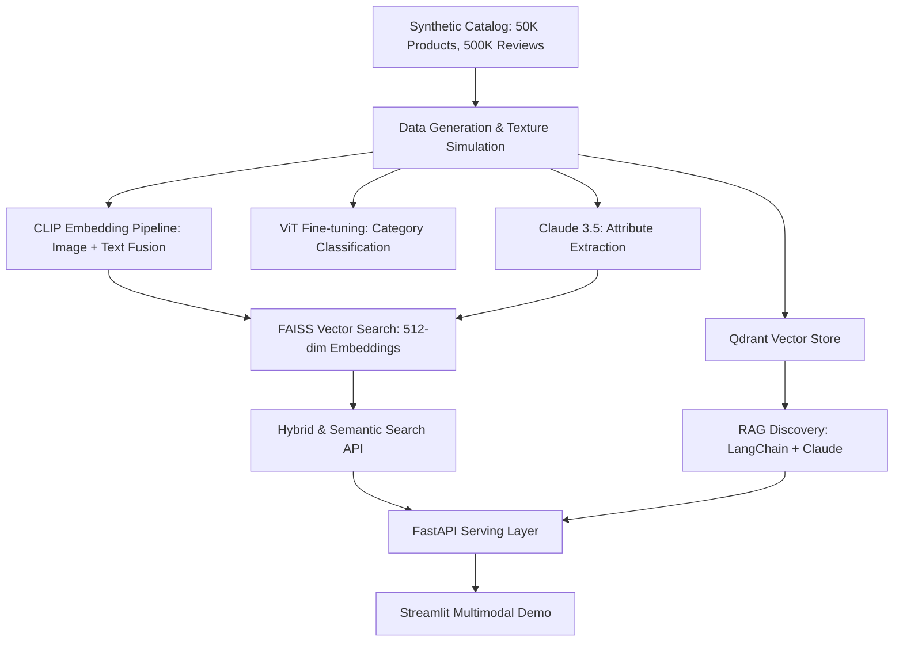

# Multimodal Product Intelligence Platform

A production-grade E-commerce intelligence platform leveraging CLIP for multimodal search, ViT for visual classification, and RAG for conversational product discovery.

## 🚀 Architecture


## 🧪 Status & Evaluation
The catalog is **synthetic** (generated by `generate_data.py`), and the product images are generated, not real photos. This repo demonstrates the pipeline design: embedding, vector search, hybrid ranking, RAG and serving. It is **not** a benchmark of real-world model accuracy.

- **Tested:** the pure-logic parts have unit tests (`tests/`): embedding fusion, FAISS index-type selection, accuracy calculation, retry backoff, hybrid search, RAG retrieval/re-ranking, attribute extraction, description-quality scoring.
- **Not yet measured:** classification accuracy, search latency and RAG groundedness have not been evaluated with a reproducible script, so no numbers are published here. Because each synthetic category has a fixed base colour, an accuracy figure on this data would say little about real products.

## 🛠️ Tech Stack
- **Deep Learning**: PyTorch, Transformers (HuggingFace), CLIP, ViT
- **Vector DB/Search**: FAISS, Qdrant
- **LLM/RAG**: LangChain, Anthropic Claude 3.5 Sonnet
- **Backend**: FastAPI, Pydantic, Redis
- **Frontend**: Streamlit, Plotly
- **Infrastructure**: Docker, MLflow, Git

## 📦 Project Structure
- `generate_data.py`: Synthetic catalog generator (writes CSVs and images to `data/`).
- `/embeddings`: CLIP and ViT training/inference pipelines.
- `/llm_pipelines`: Attribute extraction, Q&A, and description generation.
- `/vector_search`: FAISS management and hybrid search logic.
- `/serving`: FastAPI backend with caching and schemas.
- `/streamlit`: Interactive dashboard and search demo.
- `/docs`: Interview-prep Q&A on the techniques used here.
- `/tests`: Unit tests for the pipeline logic.

## ⚙️ Local Setup
1. **Clone repository**:
   ```bash
   git clone https://github.com/TarunSinghChauhan/Multimodal-Product-Intelligence-Platform.git
   cd Multimodal-Product-Intelligence-Platform
   ```
2. **Install Dependencies**:
   ```bash
   pip install -r requirements.txt
   ```
3. **Generate Data**:
   ```bash
   python generate_data.py
   ```
4. **Compute Embeddings**:
   ```bash
   python embeddings/clip_pipeline.py
   ```
5. **Run Serving API**:
   ```bash
   uvicorn serving.main:app --reload
   ```
6. **Launch Demo**:
   ```bash
   streamlit run streamlit/app.py
   ```

